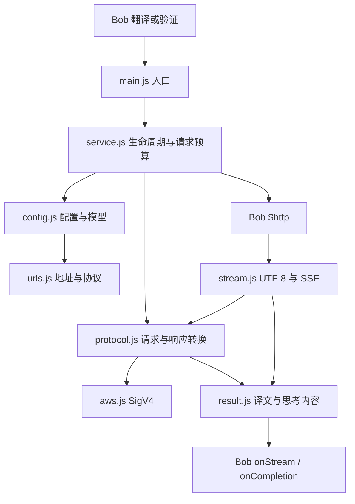

# 架构与验证 / Architecture and verification

## 运行边界

Bob 使用 JavaScriptCore，不提供浏览器、Node.js、fetch、TextDecoder 或 Node 内置模块。插件使用 Bob 原生 CommonJS、`$http` 和 `$data`；不需要安装运行依赖。



- `service.js`：参数校验、现代/旧回调择一、一次完成、取消订阅及销毁、错误收口、验证与翻译共用路径。
- `config.js` / `urls.js`：保存值保持不变；完整端点决定有效协议；路径与 query 分开处理。根地址按用户选定协议补齐路径。
- `protocol.js`：OpenAI Chat/Responses、Gemini Native、Claude Messages、AWS Converse 请求与响应；完成、拒绝、过滤和截断状态。
- `stream.js`：跨网络包的 UTF-8 解码、SSE 多行事件与尾帧、delta 逐字追加、完整快照替换、独立的每请求状态。
- `aws.js`：无依赖的 SigV4/SHA-256/HMAC；通过 `$data.fromUTF8` 发送签名原始字节。
- `result.js` / `languages.js` / `util.js`：语言、结果格式、思考区、配置读取与脱敏错误。

## 兼容与恢复

1. 保留已有插件 identifier、所有旧选项 identifier、模型选择与服务配置；普通包和 legacy 包只在 identifier 与 appcast 上不同。
2. Bob 1.21+ 同时收到 `content: {format: 'markdown', text}`；旧版读取单元素 `toParagraphs`，避免逐行 trim 破坏缩进与空行。思考区需要 Bob 1.15+，更早版本只显示正文。
3. 现代 `query.onCompletion` 优先，只有没有现代回调时才使用旧 completion，绝不同时调用。
4. 取消后忽略所有迟到帧与回调，释放本次订阅。不会移除 Bob 或其他插件的订阅。
5. 空流且 HTTP 成功时最多回退一次非流式；回退共用原请求截止时间。明确错误、截断、网络中断和取消不重发。
6. Responses 和 Claude 原生流必须收到对应完成事件，提前结束报告错误。Chat 兼容流保留对不发送 `[DONE]` 的网关的兼容。
7. 单个未处理帧最多 2 MiB，超过报告错误；不截断后冒充成功。
8. 错误展示会隐藏本次配置的密钥、AWS 凭据与接口 query 值，不记录完整请求。

## 检查与打包

```bash
npm run check
npm test
npm run build
npm run verify
```

Node.js 20+、Python 3.9+，无需 `npm install`。测试使用 Node 内置 test/VM/crypto；覆盖多个协议、任意文本/字节分包、并发、取消、错误、格式、配置与 SHA/HMAC。Node 测试不等价于 Bob 实机验收；安装后仍需通过 Bob 验证按钮和真实翻译路径。

`build.py` 生成确定性 ZIP，递归包含运行模块，固定 ZIP 时间、权限及顺序。`--check` 比较归档字节与当前源码，避免旧安装包混入新代码。自动 CI 只校验，不发布或部署。

## 发布边界

源码与本地安装包版本为 0.2.0。`appcast*.json` 仍指向已有的 v0.1.24 Release，直到实际完成新版本发布后再更新。构建命令不创建 tag、Release 或改更新源。发布时应先上传两个对应安装包，验证下载及 SHA-256，再更新各自 appcast；legacy identifier 不应改变。

## English

The plugin runs in Bob's JavaScriptCore with native CommonJS and Bob APIs, without Node or browser runtime dependencies. Entry points delegate to independent configuration, URL, protocol, stream, signing and result modules. Requests have isolated buffers, cancellation subscriptions, a shared timeout budget and one completion callback. Deltas append verbatim; snapshots replace accumulated output. Native Responses and Claude streams require terminal events. An empty successful stream may retry once without streaming; errors and cancellation never retry.

Build and verification require Node 20+ and Python 3.9+, with no package installation. Deterministic archives include every runtime module. Automated tests do not establish live provider availability; verify in the installed Bob app. Building or pushing source does not publish a GitHub Release. Existing appcasts remain on the published release until a release is explicitly completed.

## 协议依据 / Protocol references

- [Bob JavaScriptCore 与模块](https://bobtranslate.com/plugin/api/module.html)
- [Bob HTTP、流式和取消](https://bobtranslate.com/plugin/api/http.html)
- [Bob 1.21 结果格式与旧版兼容](https://bobtranslate.com/plugin/object/translateresult.html)
- [OpenAI Responses 流式事件](https://developers.openai.com/api/docs/guides/streaming-responses)
- [Gemini 内容生成](https://ai.google.dev/api/generate-content)
- [Claude Messages 流式事件](https://platform.claude.com/docs/en/build-with-claude/streaming)
- [AWS Converse](https://docs.aws.amazon.com/bedrock/latest/APIReference/API_runtime_Converse.html)

流式重复字符的原始复现由 [PR #1](https://github.com/GravityPoet/Bob-DeepThink-Free-ChatGPT-Gemini-Claude/pull/1) 提供；本次基于该问题扩展了分包、生命周期与多协议回归。
